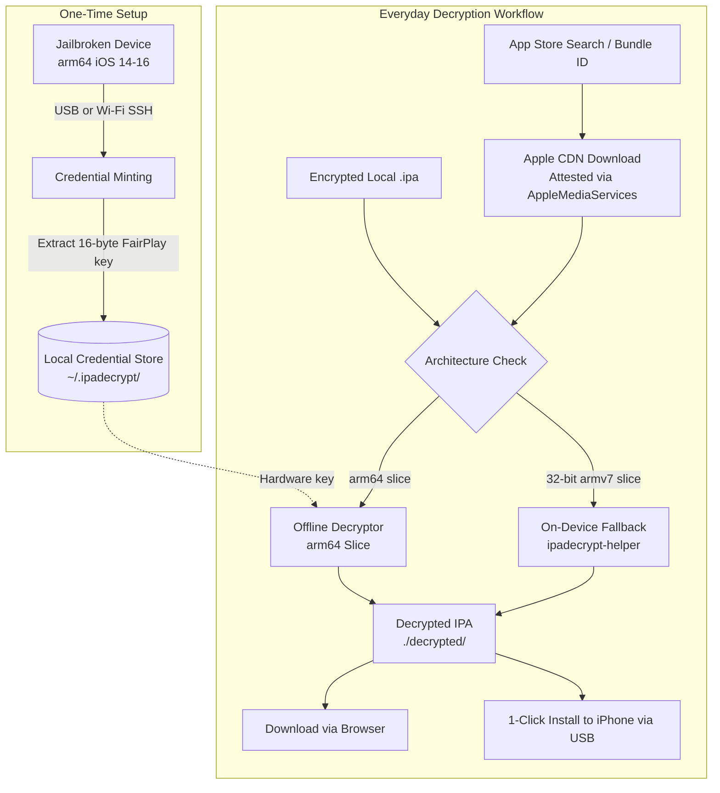

# ipadecrypt-webGUI

<p align="center">
  
</p>

<p align="center">
  <strong>A modern, full-featured Web GUI & CLI suite for decrypting FairPlay-encrypted iOS/iPadOS App Store apps.</strong>
</p>

<p align="center">
  <a href="README.md"><strong>English</strong></a> •
  <a href="README.vi.md"><strong>Tiếng Việt</strong></a>
</p>

<p align="center">
  
  
  
  
  
</p>

---

## 📖 Overview

**ipadecrypt-webGUI** is a graphical web interface and enhanced toolkit built upon [ipadecrypt](https://github.com/londek/ipadecrypt). It allows security researchers, reverse engineers, and iOS developers to download genuine App Store applications and decrypt their FairPlay DRM protection.

### Why ipadecrypt-webGUI?

Traditional iOS app dumping methods (such as *frida-ios-dump*, *Clutch*, or *bfdecrypt*) require:
1. Installing the target app onto a physical jailbroken device.
2. Launching the application into memory.
3. Hooking into the running process to dump decrypted Mach-O pages from RAM.

**ipadecrypt revolutionizes this workflow:**
- **1-Time Hardware Credential Minting**: Connect an arm64 jailbroken device **once** to extract a 16-byte FairPlay hardware decryption key bound to your Apple ID.
- **100% Offline Decryption**: After minting, any modern `arm64` App Store app can be downloaded and decrypted directly on your computer (**no jailbroken device or physical iPhone required**)!
- **On-Device Fallback**: If an older application contains legacy 32-bit (`armv7`) binary slices, the tool automatically delegates decryption to the jailbroken device helper.
- **Integrated WebGUI**: Clean dark/light user interface, multi-account management, App Store search, historical version rollback, and 1-click device installation via bundled `libimobiledevice` utilities.

---

## ✨ Features

- **🌐 Modern Web Interface & Dual Language**:
  - Responsive dark & light themes.
  - Native bilingual support (English & Tiếng Việt) with instant language switching.
- **👥 Multi-Account Apple ID Manager**:
  - Store and manage multiple Apple accounts across different regions.
  - Full support for Two-Factor Authentication (2FA) with 6-digit verification code prompt.
  - Instant one-click active account switching.
  - Visual status badges showing whether an account has minted FairPlay credentials.
- **🔍 App Store Search Engine**:
  - Search by app title, developer, keywords, or Bundle ID.
  - Multi-storefront support (US, Vietnam, Japan, Korea, UK, Germany, France, China, etc.).
  - Instant app inspection (icon, category, pricing, version, supported architectures).
  - 1-click "Download & Decrypt" or "Browse Versions".
- **🔓 Decryption Dashboard**:
  - **From App Store**: Input Bundle ID, App ID, or App Store URL to download and decrypt automatically.
  - **From Local Machine**: Drag-and-drop or upload pre-downloaded encrypted `.ipa` files.
  - Advanced flags supported:
    - `--external-version-id`: Decrypt specific historical versions.
    - `--storefront`: Override storefront country code / ID.
    - `--skip-appex`: Skip app extensions (`PlugIns/*.appex`) for faster processing.
    - `--patch-device-type`: Expand `UIDeviceFamily` in `Info.plist` to allow installing iPad apps on iPhones or vice versa.
    - `--extra-verify`: Strict Mach-O byte-comparison check against original files.
    - `--no-verify`: Skip cryptid verification.
    - Mode selection: Automatic, Force On-Device, or Pure Offline.
  - Real-time progress bar, transfer speeds, and live logs.
- **📜 App Store Version History & Rollback**:
  - Query all historical release versions registered on Apple's servers.
  - View external version IDs, marketing version strings, and release dates.
  - Download and decrypt any previous build with one click.
- **📱 Jailbreak Device & Credential Minting**:
  - Connect via **USB** (automatic `iproxy` tunnel) or **Wi-Fi SSH** (`host:port`, `root:alpine`).
  - Automated diagnostic check: OpenSSH root login, `AppSync Unified`, `appinst`, and helper binaries.
  - 1-Click FairPlay Credential Minting to unlock perpetual offline decryption.
- **📂 File Manager & Direct iOS Device Installation**:
  - Browse, download, or delete decrypted `.ipa` files stored in `./decrypted`.
  - Built-in `libimobiledevice` Windows binaries (`idevice_id`, `idevicename`, `ideviceinstaller`).
  - Detects connected USB iOS devices and installs decrypted IPAs directly with one click!

---

## 🏗️ Architecture & Workflow



---

## 📋 Requirements & Prerequisites

### For Host PC (Running the WebGUI / CLI)
- **Operating System**: Windows 10/11 (64-bit), macOS 11+, or Linux.
- **Go**: 1.25 or newer (only needed if building from source).
- **Network**: Internet connection for downloading IPAs from Apple CDN.
- **USB iOS Drivers (Windows only)**: Apple Mobile Device Support (installed automatically with iTunes or Apple Devices app).

### For One-Time Credential Minting (Jailbroken Device)
- An **arm64** physical device running jailbroken iOS/iPadOS (iPhone 6s through iPhone X, or compatible iPads on iOS 14.x - 16.x).
  - Compatible jailbreaks: **palera1n**, **Dopamine**, **checkra1n**, **unc0ver**, **Taurine**, etc.
- Packages installed on the device (via Sileo, Zebra, or Cydia):
  1. **OpenSSH** (SSH service enabled on port 22 with root password, default `alpine`).
  2. **AppSync Unified** (Repo: `https://lukezgd.github.io/repo` or Karen's Repo).
  3. **appinst** (Command line app installer from Karen's Repo or BigBoss/Procursus).

> [!NOTE]
> Once the credential minting is completed for an Apple ID, the jailbroken device is **no longer required** for standard arm64 app decryption.

---

## 🚀 Quick Start (Windows)

1. **Download / Clone this repository**:
   ```sh
   git clone https://github.com/blackcatxhan/ipadecrypt-webGUI.git
   cd ipadecrypt-webGUI
   ```

2. **Launch the WebGUI**:
   - Simply double-click **`ipadecrypt-gui.bat`** (or run `.\ipadecrypt-gui.ps1` in PowerShell).
   - Alternatively, from the command line:
     ```sh
     .\ipadecrypt.exe gui
     ```

3. **Access the Interface**:
   - Your default browser will automatically open:
     ```
     http://127.0.0.1:54322
     ```
   - Decrypted IPAs will be saved to `./decrypted/`.

---

## 🛠️ Building from Source

If you want to compile `ipadecrypt.exe` from source:

### Prerequisites
- Install **Go 1.25+** from [go.dev/dl](https://go.dev/dl/).
- Ensure `go` is available in your system `PATH`.

### Build on Windows
Run the automated build script:
```cmd
build.bat
```

Or manually using the Go CLI:
```cmd
go build -trimpath -ldflags="-s -w" -o ipadecrypt.exe ./cmd/ipadecrypt
```

### Build on macOS / Linux
```sh
go build -trimpath -ldflags="-s -w" -o ipadecrypt ./cmd/ipadecrypt
```

*Note: All web assets (`gui_assets/`) and device payloads (`internal/credmint/bundle/`) are embedded into the single binary using `go:embed`.*

---

## 📚 Step-by-Step Setup & Usage Guide

### Step 1: Sign in with Apple ID
1. Navigate to the **"Apple ID Accounts"** (`Tài khoản Apple ID`) tab in the WebGUI.
2. Enter your Apple ID email and password.
3. Click **"Log In"** (`Đăng nhập`).
4. If Two-Factor Authentication (2FA) is enabled, a modal will appear. Check your trusted Apple device and enter the 6-digit verification code.
5. Once logged in, your account will appear with a yellow status badge indicating `Credentials: Not Minted`.

> [!TIP]
> You can add multiple Apple IDs (e.g., US, Vietnam, Japan) and switch between them anytime with a single click.

---

### Step 2: One-Time FairPlay Credential Minting
1. Connect your jailbroken iPhone/iPad to your computer via USB (recommended) or ensure it is on the same Wi-Fi network.
2. Go to the **"Device & Mint"** (`Thiết bị & Mint`) tab.
3. Configure the connection settings:
   - **USB Mode**: Check "Connect via USB cable (uses iproxy)" *(Recommended)*.
   - **Wi-Fi Mode**: Enter device IP address (e.g. `192.168.1.100`), Port `22`, User `root`, Password `alpine`.
4. Click **"Save Configuration"** then **"Test Connection"**.
   - The system checks OpenSSH root access, AppSync Unified, appinst, and helper execution.
5. Click **"Mint Credential"** (`Tạo chứng chỉ FairPlay`).
6. Wait 5-15 seconds while the tool signs, uploads, and executes the tiny extraction payload.
7. Upon completion, your account badge turns green: `Credentials: Minted`! You can now unplug your jailbroken iPhone.

---

### Step 3: Decrypting Apps

#### Option A: Direct from App Store
1. Go to the **"Decrypt IPA"** (`Giải mã IPA`) tab.
2. Ensure **"App Store"** source is selected.
3. Enter the **Bundle ID** (e.g., `com.spotify.client`), **App ID** (e.g., `324684580`), or full **App Store URL**.
4. Configure optional parameters:
   - Specific version ID (leave blank for latest).
   - Storefront country override.
   - Patch device type, skip app extensions, or verification options.
5. Click **"Start FairPlay Decryption"**.
6. Track live download and decryption progress in the monitoring panel.

#### Option B: Search the App Store First
1. Go to the **"App Store Search"** tab.
2. Type an app name or keyword and pick the country storefront (e.g., US, VN, JP).
3. Click **"Decrypt"** on the target card to populate the decryption dashboard immediately.

#### Option C: Decrypt Local `.ipa` Files
1. In the **"Decrypt IPA"** tab, switch the source selector to **"Local IPA File"**.
2. Drag and drop or browse for an encrypted `.ipa` file from your computer.
3. Click **"Start FairPlay Decryption"**.

---

### Step 4: Version Rollback (Historical Releases)
1. Go to the **"Version History"** (`Lịch sử phiên bản`) tab.
2. Enter the Bundle ID or App ID and click **"Lookup Versions"**.
3. A complete table of historical releases will be fetched from Apple's servers.
4. Click **"Decrypt this version"** on any row to download and decrypt that specific historical build!

---

### Step 5: App Watchlist & Automatic Update Tracking
1. You can bookmark any application (🔖 Bookmark button):
   - From search results in the **"App Store Search"** tab.
   - Or from local decrypted files in the **"Decrypted Files"** tab.
2. Go to the **"Watchlist"** (`Theo dõi (Watchlist)`) tab:
   - WebGUI compares the latest release available on the App Store against your locally decrypted IPA in `./decrypted`.
   - If a newer version is released on the App Store, the card highlights an **`UPDATE AVAILABLE`** badge and the navigation tab displays a red update counter.
   - Click **"Download & Decrypt Update"** to switch to the decrypt screen with the latest version pre-configured in 1 click!
   - Click **"Check for Updates Now"** to scan Apple's servers for all tracked apps at once.

---

### Step 6: Managing Files & 1-Click iOS Installation
1. Go to the **"Decrypted Files"** (`Tệp đã giải mã`) tab.
2. Here you can:
   - Click **"Open Folder in Explorer"** to open the `./decrypted` directory.
   - Click **"Download"** to save the IPA through your browser.
   - Click **"Install to Device"**: Connect any non-jailbroken or jailbroken iPhone/iPad via USB, select your device from the dropdown, and install the decrypted IPA directly using the bundled `ideviceinstaller`!

---

## ⚙️ Advanced Decryption Options Reference

| GUI Option | CLI Flag | Description | Recommendation |
| :--- | :--- | :--- | :--- |
| **Decryption Mode** | `--on-device` / `--no-on-device` | Decides whether to use offline FairPlay key or execute on the jailbroken device. | Keep **Auto**. Use `--on-device` only for old 32-bit apps. |
| **Patch Device Type** | `--patch-device-type` | Modifies `UIDeviceFamily` in `Info.plist` to expand compatibility across iPhone and iPad. | Check if you want to run an iPad-only app on an iPhone. |
| **Skip App Extensions** | `--skip-appex` | Skips decrypting plugins in `Payload/<App>.app/PlugIns/*.appex`. | Speeds up decryption if extensions are not needed. |
| **Extra Verification** | `--extra-verify` | Performs byte-comparison against original Mach-O outside encrypted segments to detect corruption. | Recommended for critical reverse engineering. |
| **Skip Verification** | `--no-verify` | Skips post-decrypt Mach-O header validation. | Keep unchecked unless diagnosing header anomalies. |
| **Specific Version** | `--external-version-id` | Pins download to a specific App Store internal version ID. | Use when rolling back to older app versions. |
| **Storefront Override** | `--storefront` | Overrides App Store storefront ID or country code (e.g. `US`, `VN`, `143441`). | Use when downloading geo-restricted apps. |

---

## 💻 CLI Commands & Usage

`ipadecrypt` can also be run entirely from the terminal:

```sh
# Start the Web GUI server
ipadecrypt gui --port 54322 --host 127.0.0.1 --output-dir ./decrypted

# Interactive setup & credential minting via terminal
ipadecrypt bootstrap

# Decrypt by Bundle ID, App ID, or App Store URL
ipadecrypt decrypt com.spotify.client
ipadecrypt decrypt 324684580 --output ./Spotify.ipa
ipadecrypt decrypt "https://apps.apple.com/us/app/spotify-music-and-podcasts/id324684580"

# Decrypt a local encrypted .ipa file
ipadecrypt decrypt /path/to/encrypted.ipa --output ./decrypted.ipa

# Decrypt a specific historical version
ipadecrypt decrypt com.spotify.client --external-version-id 858584852

# Browse version history interactively
ipadecrypt versions com.spotify.client
```

---

## 📁 Project Directory Structure

```
ipadecrypt-webGUI/
├── cmd/
│   └── ipadecrypt/
│       ├── gui.go                 # Web server, routing & SPA handler
│       ├── gui_accounts.go        # Multi-account Apple ID management & 2FA
│       ├── gui_batch.go           # Batch decryption queue handler
│       ├── gui_decrypt.go         # Decryption job orchestration
│       ├── gui_device.go          # SSH & iproxy device minting handlers
│       ├── gui_files.go           # Decrypted file manager APIs
│       ├── gui_install.go         # libimobiledevice iOS install bridge
│       ├── gui_search.go          # App Store search API handler
│       ├── gui_versions.go        # Version history API handler
│       ├── main.go                # Cobra CLI root commands
│       └── gui_assets/            # Embedded frontend web application
│           ├── index.html         # Single Page Application HTML
│           ├── style.css          # Dark/Light responsive CSS styling
│           └── app.js             # Frontend reactive logic & VI/EN i18n
├── helper/                        # On-device C decryptor helper (arm64)
├── internal/
│   ├── apphttp/                   # Apple Store API client
│   ├── credmint/                  # FairPlay hardware key extraction bundle
│   ├── decrypt/                   # Offline Mach-O FairPlay decryptor engine
│   ├── device/                    # SSH, SCP & iproxy communication layer
│   └── store/                     # AppleMediaServices attestation emulator
├── tools/                         # Bundled Windows libimobiledevice binaries
│   ├── ideviceinstaller.exe
│   ├── idevice_id.exe
│   ├── iproxy.exe
│   └── *.dll
├── decrypted/                     # Default output directory for decrypted IPAs
├── build.bat                      # 1-click Windows build script
├── ipadecrypt-gui.bat             # 1-click Windows GUI launcher (CMD)
├── ipadecrypt-gui.ps1             # 1-click Windows GUI launcher (PowerShell)
├── BUILDING.md                    # Compilation instructions
├── WINDOWS_GUI_GUIDE.md           # Windows GUI user guide
├── README.md                      # English documentation
└── README.vi.md                   # Vietnamese documentation
```

---

## ❓ Troubleshooting & FAQs

### 1. `[ERROR] Port 54322 is already in use!`
- Another instance of `ipadecrypt.exe` is already running.
- Open Windows Task Manager, find and end `ipadecrypt.exe`, or run:
  ```powershell
  Stop-Process -Name ipadecrypt -Force
  ```

### 2. SSH Connection to Jailbroken Device Failed
- Ensure **OpenSSH** is installed and running on your jailbroken device.
- If using **USB**: make sure iTunes / Apple Mobile Device Support is installed so Windows recognizes the iOS USB device. Check that `tools/iproxy.exe` is not blocked by your antivirus.
- If using **Wi-Fi**: verify that your PC and iOS device are connected to the same local Wi-Fi network and no firewall is blocking port 22.
- The default credentials are user `root` and password `alpine`.

### 3. "Cannot download app: license not found"
- Free apps must be "purchased" (acquired) on your Apple ID at least once before they can be downloaded via API. Open the App Store on any iPhone/iPad or PC with that Apple ID, click "Get" to claim the free license, then retry decryption.

### 4. How does offline decryption work without my device?
- FairPlay uses hardware-backed cryptographic keys to decrypt the app's binary pages. During the one-time **Minting** step, ipadecrypt runs a small payload on your jailbroken device to extract the master decryption token for your Apple ID. Once saved to `~/.ipadecrypt/`, the tool can decrypt any `arm64` app downloaded with that Apple ID offline without ever connecting your phone again.

---

## 🔒 Disclaimer & Legal Notice

This software is intended strictly for security research, educational purposes, interoperability analysis, and personal archival under applicable fair use and reverse engineering laws. 

Do not use this software to distribute copyrighted commercial software or infringe intellectual property rights. The authors assume no liability for misuse.

---

## 💖 Acknowledgements & Credits

- [ipadecrypt](https://github.com/londek/ipadecrypt) by **londek** — Core offline FairPlay decryption suite.
- [ipatool](https://github.com/majd/ipatool) by **majd** — App Store download attestation engine.
- [fairplay-decrypt](https://github.com/EthanArbuckle/fairplay-decrypt) by **Ethan Arbuckle** — FairPlay credential retrieval research.
- [libimobiledevice](https://libimobiledevice.org/) — Cross-platform iOS device communication libraries.
